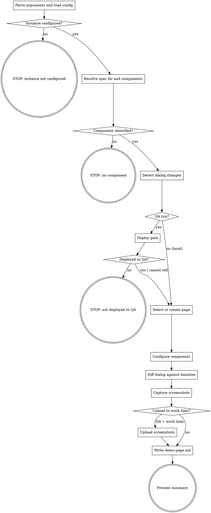

**Isolation check.** This skill is meant to run in its own context (`context: fork`). If you can see the user's messages from before this skill was invoked, you are running inline (Copilot CLI ignores `context: fork`): do not run the steps below yourself. Start one subagent with your task/subagent tool, give it only this instruction — "Invoke the dx-aem:aem-demo-page skill with these arguments: <the arguments you were given, or none>. Run it fully and reply with its final report only." — then show the user that report and stop. If you cannot see earlier user messages, or your only earlier message is that instruction to invoke dx-aem:aem-demo-page (you are a fork or that subagent), continue below.

**Platform note:** needs AEM MCP (`AEM/*`) and Playwright MCP (`playwright/*`). If they are not available, say: "aem-demo-page requires AEM and Playwright MCP servers. Please use Claude Code or Copilot CLI." and stop.

You set up one demo page per component on AEM, configure it, and capture two screenshots: the dialog (only when the dialog changed) and the author preview (`?wcmmode=disabled`). The same page serves developer testing (`--local`, before the PR), QA and the demo call (QA, after merge). Your output, `demo/demo-page.md`, is read by `/dx-doc-gen` and `/dx-qa-handoff`.

## Flow



## Node Details

### Parse arguments and load config

From `$ARGUMENTS`: a numeric token is the work item ID; `--local` selects the local instance; any other token is a component name. Default instance: **QA**.

Read `.ai/config.yaml`:
- `aem.author-url` (default `http://localhost:4502`), `aem.author-url-qa`, `aem.publish-url-qa`
- `aem.component-path`, `aem.resource-type-pattern`, `aem.component-prefix`, `aem.demo-parent-path`, `aem.content-paths`
- `scm.base-branch`, `scm.org`, `scm.project`

Set `ENV` = `qa` or `local`, `AUTHOR_URL` accordingly. Every AEM MCP call in this run passes `instance: "<ENV>"`.

### Instance configured?

QA run needs `aem.author-url-qa`. Local run always passes (localhost default).

### STOP: instance not configured

```
BLOCKED: aem.author-url-qa is not set in .ai/config.yaml. Set it, or run /aem-demo-page --local.
```

### Resolve spec dir and components

```bash
SPEC_DIR=$(bash .ai/lib/dx-common.sh find-spec-dir <work-item-id-if-given>)
```

No spec dir and no component name → ask for one (interactive) or STOP (non-interactive, `../../../dx-core/shared/interaction-mode.md`). A component name without a spec dir is fine: write output under `.ai/specs/demo-<component>/`.

Components, first match wins: the arguments → `demo/demo-page.md` from an earlier run → `implement.md` step titles and file paths (`<aem.component-path>/<name>/…`) → `explain.md`. Several components are fine — handle each one in the nodes below.

**New component?** — not present under `aem.component-path` on the target instance (`getNodeContent` on `<component-path>/<name>` fails) or created by this story (`implement.md` creates its folder).

### Component identified?

At least one component resolved → "yes".

### STOP: no component

```
Cannot identify the component — pass it: /aem-demo-page <component> [<work-item-id>]
```

### Detect dialog changes

Per component, `DIALOG_CHANGED` = the change touches `**/<name>/_cq_dialog/**`, or the component is new.

- **Local:** `git diff --name-only origin/<scm.base-branch>...HEAD` plus `git diff --name-only HEAD` (uncommitted).
- **QA**, first that works:
  1. `.branch` in the spec dir names a branch that still exists → `git diff --name-only origin/<scm.base-branch>...<branch>` using its merge-base.
  2. The merge commit on the base branch: `git log origin/<scm.base-branch> --format=%H -1 --grep="<work-item-id>"` → `git show --name-only --format= -m --first-parent <sha>`.
  3. Unknown → treat as changed and note `dialog change unknown — screenshot taken anyway`.

### QA run?

`ENV` = `qa` → "yes".

### Deploy gate

Confirms the merged change is on QA before anything is written to it. Per component:

- **New component:** the component node exists on QA (`getNodeContent <component-path>/<name>`).
- **Dialog changed:** collect `name="./…"` values from the repo's `<name>/_cq_dialog/.content.xml`; collect `name` properties from QA's `<component-path>/<name>/_cq_dialog` (`getNodeContent`, depth 10). Every repo field present on QA → deployed.
- **Neither (FE/HTL/Java only):** no reliable JCR signal → `cannot tell`. Print `Deploy state unknown for <name> (no dialog change) — make sure the QA build ran.` and continue.

### Deployed to QA?

Any component that fails its check → "no".

### STOP: not deployed to QA

```
Not deployed to QA yet: <component> (<missing fields | component missing>). Re-run after the QA deploy.
```

Write nothing to QA. (`/dx-post-merge` stops here too.)

### Select or create page

Read `../../shared/demo-page-setup.md` and apply it: Page Selection Rule, structure discovery, page creation, `demo/page-structure.md` cache.

- **QA run with a local entry in `demo-page.md`:** try that page path first — the same JCR path is what the developer tested. Use it if it exists on QA with the component; create it there if the component is new.
- **Existing component:** reuse the best representative existing page; do not create one.
- **New component:** create `<aem.demo-parent-path>/<spec-slug>` (fallback `<language-root>/demo/<spec-slug>`), recreate the container chain, add the component.

Record per page: path, `created` (true/false), components on it.

### Configure component

Only on pages this skill created, or a component this skill added. Never change authored values on a reused production page.

Per `demo-page-setup.md` → Demo Data Configuration: real values from an existing authored instance first; mock only new fields with no real data (`Test <label>`, booleans `true`, selects first option). Make sure every **new or changed** dialog field has a value, so the preview shows the change. Record the field values set.

### Diff dialog against baseline

Only when `$SPEC_DIR/aem-before.md` exists (from `/aem-snapshot`) and the run is local. Walk the current dialog (`getNodeContent` on `_cq_dialog`, depth 10) and compare field names with the baseline tables: `added`, `removed`, `unchanged`. A removed field that the plan does not remove is a **regression** — say so in the summary.

### Capture screenshots

Follow the agent's "Dialog screenshot" and "Preview screenshot" procedures. Authenticate first with `bash .ai/lib/aem-playwright-auth.sh author <ENV>`.

- Dialog — only when `DIALOG_CHANGED`: `demo/<ENV>/dialog-<component>.png` (plus `-<tab>` files for other tabs with changed fields).
- Preview — always: `<AUTHOR_URL><page>.html?wcmmode=disabled` → `demo/<ENV>/preview-<component>.png`.

A failed capture is not fatal: record `missing: <reason>` for that screenshot and continue.

### Upload to work item?

QA run, a work item ID is known, and `tracker.provider` is `ado` (default). Otherwise skip — local screenshots stay local; for Jira print `Screenshots not uploaded (Jira attachments not supported yet).`

### Upload screenshots

Per QA screenshot — named `<id>-<file>` so re-runs replace the earlier copy:

```bash
bash .ai/lib/upload-attachment.sh --org "<scm.org>" --project "<scm.project>" --id <id> \
  --file "$SPEC_DIR/demo/qa/<file>" --name "<id>-<file>"
```

Stdout is the attachment URL. On failure, keep going without a URL and note the error (`no credentials` → set `ADO_PAT` or `az login`).

### Write demo-page.md

Write `$SPEC_DIR/demo/demo-page.md`. Keep the other environment's block if the file exists — replace only `environments.<ENV>`.

```markdown
---
work-item: <id or null>
environments:
  <ENV>:
    updated: <ISO-8601>
    author-url: <AUTHOR_URL>
    dialog-changed: <true|false|unknown>
    dialog-diff: { added: [...], removed: [...], unchanged: [...] }   # local, with aem-before.md only
    pages:
      - path: <page path>
        created: <true|false>
        author-edit: <AUTHOR_URL>/editor.html<page>.html
        author-preview: <AUTHOR_URL><page>.html?wcmmode=disabled
        publisher: <aem.publish-url-qa><page>.html        # qa only
        components:
          - name: <component>
            new: <true|false>
            node: <component node path>
            fields: { <name>: <value>, ... }               # values this run set or found
    screenshots:
      - { file: demo/<ENV>/dialog-<component>.png, kind: dialog, component: <component>, url: <attachment URL> }   # url: qa only
      - { file: demo/<ENV>/preview-<component>.png, kind: preview, component: <component>, url: <attachment URL> }
---
# Demo page — <story title or component>

| Env | Page | Edit | Preview |
|-----|------|------|---------|
| <ENV> | `<path>` | [Edit](<author-edit>) | [Preview](<author-preview>) |

<notes: regressions, missing screenshots, deploy-state warnings>
```

Facts only — field descriptions for editors are written by `/dx-doc-gen`.

### Present summary

```markdown
## aem-demo-page complete — <ENV>

**Page:** <path> (<created|reused>) — [Edit](<url>) · [Preview](<url>)
**Components:** <name> (<new|updated>), dialog <changed|unchanged|unknown>
**Screenshots:** <list> (<uploaded to #id | local only>)
**Dialog diff:** <N added, N removed> (local, with baseline)
**Output:** `<spec-dir>/demo/demo-page.md`
**Next:** <local: "/aem-fe-verify <component>" | qa: "/dx-doc-gen <id>, then /dx-qa-handoff <id>">
```

## Examples

1. `/aem-demo-page hero --local` — while developing: reuses the best page with hero on local AEM, dialog changed in the branch → captures dialog + preview into `demo/local/`, diffs the dialog against `aem-before.md`.
2. `/aem-demo-page 12345` — after merge: deploy gate passes, reuses the page path from the local run, captures on QA, uploads `12345-dialog-hero.png` and `12345-preview-hero.png` to the work item.
3. `/aem-demo-page 12345` before the QA deploy — the new `variant` field is missing on QA → `Not deployed to QA yet`, nothing written.

## Rules

- **One instance per run** — every AEM MCP call carries `instance: "<ENV>"`; never mix local and QA.
- **Page Selection Rule** — reuse for existing components, create only for new ones; never edit authored values on a reused page.
- **Dialog screenshot only when the dialog changed** (or the component is new).
- **Preview from the author** (`wcmmode=disabled`) — no publish, no publisher polling.
- **Idempotent, not cached** — reuse the page, re-capture the screenshots every run; there is no "already up to date" skip.
- **Read config for every URL and path** — never hardcode hosts, content paths or component paths.
