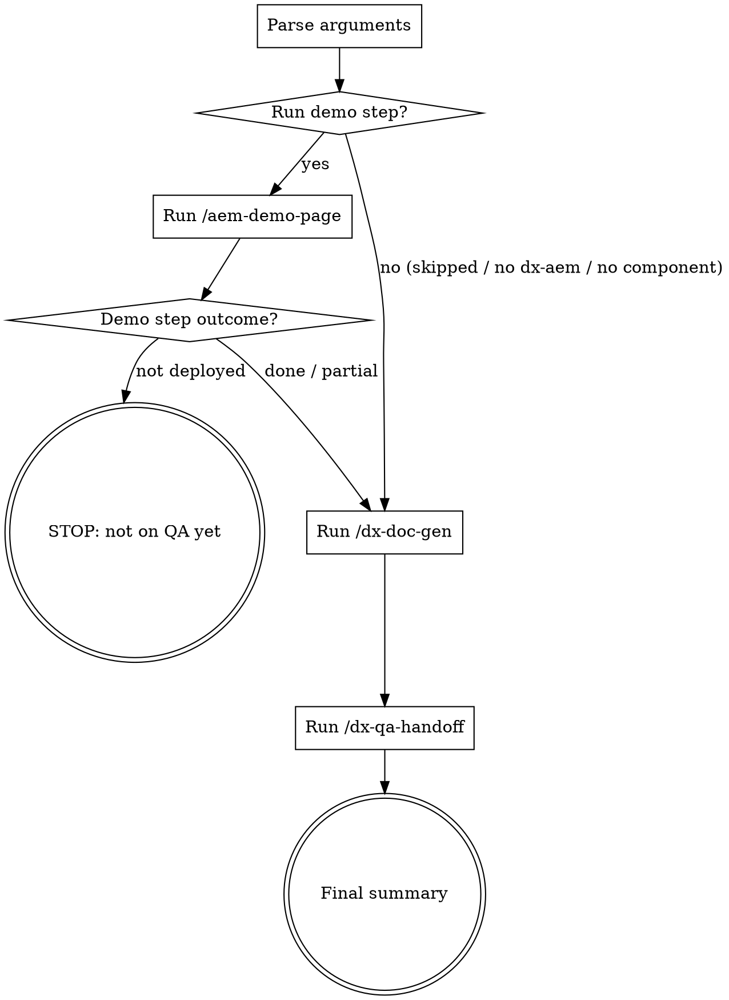

You are a coordinator. You run three skills in order through the Skill tool and never do their work yourself:

| Step | Skill | Output it leaves for the next step |
|------|-------|------------------------------------|
| demo | `/aem-demo-page <id>` (dx-aem) | `demo/demo-page.md` — QA page URLs, screenshot attachment URLs |
| docs | `/dx-doc-gen <id>` | wiki page, `.wiki-url` |
| handoff | `/dx-qa-handoff <id>` | `[QAHandoff]` comment on the story |

Each skill also works on its own — this coordinator only saves typing and keeps the order right. Run it once the merged change is deployed to QA; it is started by hand (a comment trigger is planned).

## Flow



`--skip docs` / `--skip handoff` turn those boxes into a `skipped` row and pass straight through.

## Node Details

### Parse arguments

- Work item ID (number or work item URL) — required. Missing → ask (interactive) or a `failed` run (non-interactive, `../../shared/interaction-mode.md`).
- `--skip <step>` — repeatable; `demo`, `docs`, `handoff`.
- `dry run` — passed on to `/dx-doc-gen` (no wiki post) and `/dx-qa-handoff` (no comment). `/aem-demo-page` still runs (it writes only the demo page and attachments on the story) — add `--skip demo` to avoid that.

Find or create the spec dir: `SPEC_DIR=$(bash .ai/lib/dx-common.sh find-spec-dir <id>)`. None is fine — `/dx-doc-gen` creates it in retro mode; resolve it again after that step.

Start the run and the progress file, and mark the run as orchestrated so the sub-skills don't stop to ask:

```bash
bash "${CLAUDE_PLUGIN_ROOT}/data/lib/run-result.sh" --start --skill dx-post-merge --id <id> --progress-file post-merge-progress.md
mkdir -p .ai/run-context && touch .ai/run-context/orchestrating.flag
bash ${CLAUDE_PLUGIN_ROOT}/skills/dx-post-merge/scripts/update-progress.sh "$SPEC_DIR" "demo" "pending"   # and docs, handoff
```

(Skip the progress calls while `SPEC_DIR` is unknown; write them once it exists.)

### Run demo step?

"yes" when all hold:
- `demo` not in `--skip`
- the `aem-demo-page` skill is available (dx-aem installed)
- the story touches an AEM component — `implement.md` / `explain.md` name one, or `demo/demo-page.md` exists

Otherwise "no"; write the `demo` row as `skipped` with the reason.

### Run /aem-demo-page

```bash
bash ${CLAUDE_PLUGIN_ROOT}/skills/dx-post-merge/scripts/update-progress.sh "$SPEC_DIR" "demo" "in_progress"
```

Invoke `Skill(/aem-demo-page <id>)` — QA instance (the default). Refresh the orchestration flag after it returns.

### Demo step outcome?

- Report says `Not deployed to QA yet` → "not deployed" (`demo` row `blocked`).
- Page set up, possibly with a missing screenshot → "done / partial" (`demo` row `done`, note any missing screenshot).
- Any other failure (AEM MCP down, QA URL not configured) → write the row `failed` with the reason and continue to docs: the wiki page and handoff still help, and they say the demo page is missing.

### STOP: not on QA yet

Docs and handoff without the QA page are the wrong result right after a merge, so stop.

```bash
rm -f .ai/run-context/orchestrating.flag
bash "${CLAUDE_PLUGIN_ROOT}/data/lib/run-result.sh" --skill dx-post-merge --id <id> --status blocked \
  --next "/dx-post-merge <id> after the QA deploy" --metric fail_at=demo
```

Print: `Not deployed to QA yet — re-run /dx-post-merge <id> after the QA deploy (or --skip demo for docs and handoff now).`

### Run /dx-doc-gen

Unless `docs` is skipped: row `in_progress`, invoke `Skill(/dx-doc-gen <id>)` with `PIPELINE_MODE`/wiki posting as the caller has it — in a local run, add "post to wiki" to the arguments so the page lands on the wiki (unless `dry run`). Row `done` with the wiki path, or `failed` with the reason. A failure does not stop the run: the handoff says the wiki is missing.

Resolve `SPEC_DIR` again if it was unknown (retro mode created it).

### Run /dx-qa-handoff

Unless `handoff` is skipped: row `in_progress`, invoke `Skill(/dx-qa-handoff <id>)` (pass `dry run` through). Row `done` / `failed`.

### Final summary

```bash
rm -f .ai/run-context/orchestrating.flag
```

```markdown
## Post-merge complete — #<id>

| Step | Status | Result |
|------|--------|--------|
| Demo page | done / skipped / failed | <QA page Edit URL>, <N> screenshots uploaded |
| Wiki page | done / skipped / failed | <wiki URL> |
| QA handoff | done / skipped / failed | comment posted / update posted / unchanged |
```

Last action — per `../../shared/run-result.md`:

```bash
bash "${CLAUDE_PLUGIN_ROOT}/data/lib/run-result.sh" --skill dx-post-merge --id <id> --status <done|failed> \
  --wiki "<wiki url>" --next "<what is left, if anything>" \
  --metric steps_done=<n> --metric steps_skipped=<n> --metric screenshots=<n> [--metric fail_at=<step>]
```

`done` when no step failed; `failed` otherwise (`fail_at` = first failed step).

## Examples

1. `/dx-post-merge 12345` — demo page on QA (page reused from the local run, two screenshots uploaded), wiki page posted, `[QAHandoff]` comment posted.
2. `/dx-post-merge 12345` right after merge, before the QA deploy — demo step reports the new dialog field missing on QA → stops, nothing posted.
3. `/dx-post-merge 12345 --skip demo` — non-AEM story, or docs needed before QA is ready: wiki page + handoff comment, no QA pages.

## Rules

- **Coordinator only** — delegate every step to its skill; never create pages, write wiki content or post comments yourself.
- **Fixed order** — demo → docs → handoff. Each step reads only what earlier steps wrote.
- **Stop only on "not deployed"** — any other step failure is recorded and the run continues.
- **Every run ends with a run result** — success, STOP or failure.
