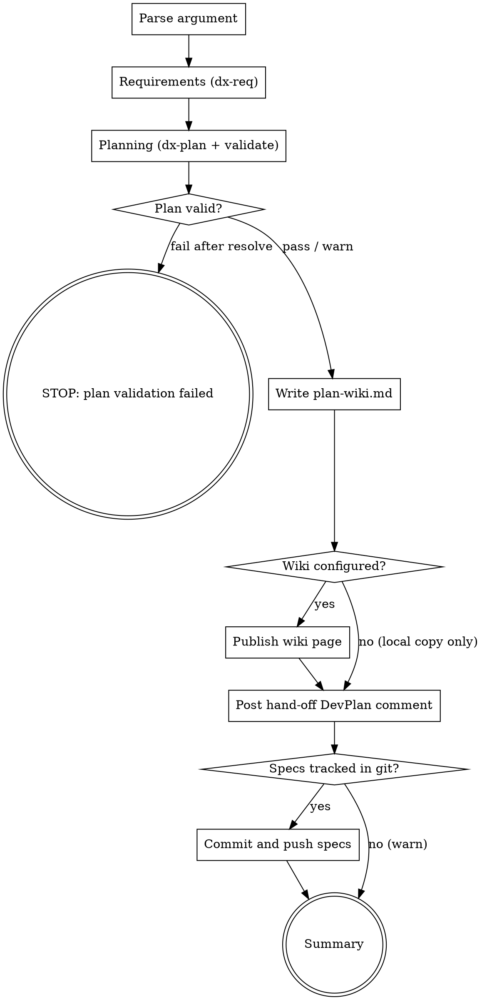

You prepare a ticket so that someone else — a developer, or `/dx-agent-all` in a pipeline — can implement it later without redoing the analysis. You coordinate existing skills via the Skill tool and publish their result; you do no new research and write no code.

Outputs:
- Spec files in `.ai/specs/<id>-<slug>/` (from `/dx-req` and `/dx-plan`), committed and pushed on the feature branch
- `docs/plan-wiki.md` in the spec dir + a wiki page **Development Plan** under the story's doc page
- The `[DevPlan]` comment on the work item, with the wiki link, what is prepared, and the next command

Re-running is safe: every step is idempotent, the wiki page is upserted and the comment edited in place.

## Flow



## Node Details

### Parse argument

Extract the numeric work item ID (or Jira key) from the argument; ask if missing. `autonomous` → no confirmation prompts. `--force` → passed to `/dx-plan` to regenerate an existing plan.

### Requirements (dx-req)

Invoke `Skill(/dx-req <id>)`. It fetches the story (with linked items, release check and comment images), runs DoR, explain, research, creates the feature branch and posts the pre-plan `[DevPlan]` comment. Then:

```bash
SPEC_DIR=$(bash .ai/lib/dx-common.sh find-spec-dir <id>)
```

### Planning (dx-plan + validate)

Invoke `Skill(/dx-plan <id>)` (add `--force` if given), then `Skill(/dx-plan-validate <id>)`. On `verdict: fail`, invoke `Skill(/dx-plan-resolve <id>)` once and validate again. Interactive mode: on `warn`, offer `/dx-plan-resolve`; autonomous: continue.

### Plan valid?

`pass` or `warn` → continue. `fail` after one resolve → STOP.

### STOP: plan validation failed

Print `Plan validation failed — see $SPEC_DIR/validation-report.md. Fix the plan or the story, then re-run /dx-prep <id>.` Nothing is published.

### Write plan-wiki.md

Read `.ai/templates/wiki/plan-wiki.md.template` and fill it **only from spec files** — `raw-story.md`, `explain.md`, `research.md`, `dor-report.md`, `implement.md`, `plan-thinking.md`, `.sprint`, `.branch`. No new code search: if a section has no source, omit it. Write `$SPEC_DIR/docs/plan-wiki.md`.

**Status line:** read `dx-prep.review-tag` from config. If set and `raw-story.md` `**Tags:**` contains it → `Reviewed (tag <tag>)`; otherwise `Draft — not reviewed`. Omit the status part when no tag is configured.

Idempotent: if `docs/plan-wiki.md` exists and the new content is the same apart from the `Prepared:` date, keep the file and print `plan-wiki.md already up to date`.

### Wiki configured?

ADO: `scm.wiki-id` and `scm.wiki-doc-root` set. Jira: `confluence.space-key` and `confluence.doc-root` set. If not, print `Wiki not configured — plan saved locally at docs/plan-wiki.md` and continue.

### Publish wiki page

The plan is a **child page** of the story's doc page, so `/dx-doc-gen` can keep rewriting the story page after implementation without touching the plan.

**ADO** — use the same path rules as `/dx-doc-gen` section 6a (sprint folder, `Unsorted` when the sprint is unknown, reuse of an existing `<id>-` page):

```
WIKI_ROOT = <scm.wiki-doc-root>
SPRINT    = <.sprint>                       # or "Unsorted"
STORY     = <existing child of WIKI_ROOT/SPRINT starting with "<id>-">, else <id>-<slug>
PLAN_PATH = "${WIKI_ROOT}/${SPRINT}/${STORY}/Development Plan"
```

1. Ensure the sprint page exists — `mcp__ado__wiki` `action: "get_page"`; on 404, `mcp__ado__wiki_upsert_page` with `# ${SPRINT}`.
2. Ensure the story page exists — on 404, create a placeholder: `# <Title> (ADO #<id>)` + `Technical documentation follows after implementation. The prepared plan is in the child page **Development Plan**.` (`/dx-doc-gen` replaces it later).
3. Upsert the plan: `mcp__ado__wiki_upsert_page` with `wikiIdentifier: <scm.wiki-id>`, `project: <scm.wiki-project>`, `path: PLAN_PATH`, `content: <docs/plan-wiki.md>`. The upsert reads the page version (ETag) itself; on a version conflict, get the page again and retry once.
4. Write the page URL to `$SPEC_DIR/.plan-wiki-url` (one line). Use the URL the tool returns (`remoteUrl`); if none, build `<scm.org>/<wiki-project>/_wiki/wikis/<wiki-id>?pagePath=<PLAN_PATH url-encoded>`.

**Confluence** — follow `/dx-doc-gen` section 6b to find the sprint page and the story page `<id>-<slug>` (create the story page as the same placeholder if missing). Create or update a child page titled `<id> Development Plan` (Confluence titles are unique per space) with the converted content. Write its URL to `.plan-wiki-url`.

If publishing fails, print a warning and continue — the local `docs/plan-wiki.md` and the comment still help.

### Post hand-off DevPlan comment

Regenerate `share-plan.md` in **post-plan mode** and post it per `../dx-req/references/share-template.md`, including its **Hand-off Block** (wiki link from `.plan-wiki-url`, prepared phases, branch, `Next: /dx-agent-all <id>`). The existing `[DevPlan]` comment from `/dx-req` is edited in place (`dx-req.devplan-update`), so the ticket keeps one DevPlan comment.

### Specs tracked in git?

```bash
git check-ignore -q "$SPEC_DIR/implement.md" && echo ignored || echo tracked
```

`ignored` → print `⚠ .ai/specs/ is gitignored — the prepared plan stays on this machine. Replace the .ai/specs/ line in .gitignore with .ai/specs/**/images/ (see /dx-doctor), then re-run /dx-prep <id>.` and go to Summary.

### Commit and push specs

Stage **only the spec dir** — never code or other files:

```bash
BRANCH=$(cat "$SPEC_DIR/.branch" 2>/dev/null || git branch --show-current)
git add -- "$SPEC_DIR"
git diff --cached --quiet && echo "NOTHING_TO_COMMIT"
```

If there is something to commit, commit with message `#<id> Prepare development plan` (format from `../../shared/git-rules.md`). Interactive mode: show `git diff --cached --stat` and ask before pushing. Push: `git push -u origin "$BRANCH"`. A push failure is a warning, not a stop — print the command to run by hand.

### Summary

```markdown
## /dx-prep complete: #<id> <title>

- Specs: `<spec-dir>` — requirements, DoR, research, plan (<n> steps)
- Wiki: <PLAN_PATH or "local only: docs/plan-wiki.md">
- ADO: [DevPlan] comment <posted | updated | unchanged>
- Branch: `<branch>` <pushed | not pushed — reason>
- Review: <"add tag <review-tag> to the work item after reading the wiki page" | "reviewed" | omit if no tag configured>

**Next:** `/dx-agent-all <id>` — skips the prepared phases and starts from implementation.
```

## Rules

- **No duplicate work** — every section of the wiki page comes from a spec file; never re-research.
- **One comment** — edit `[DevPlan]` in place; never post a second full plan.
- **Specs only** — the commit contains the spec dir, nothing else.
- **Plain hand-off** — the plan is a default for the implementer, not a contract (`/dx-step` records deviations).
