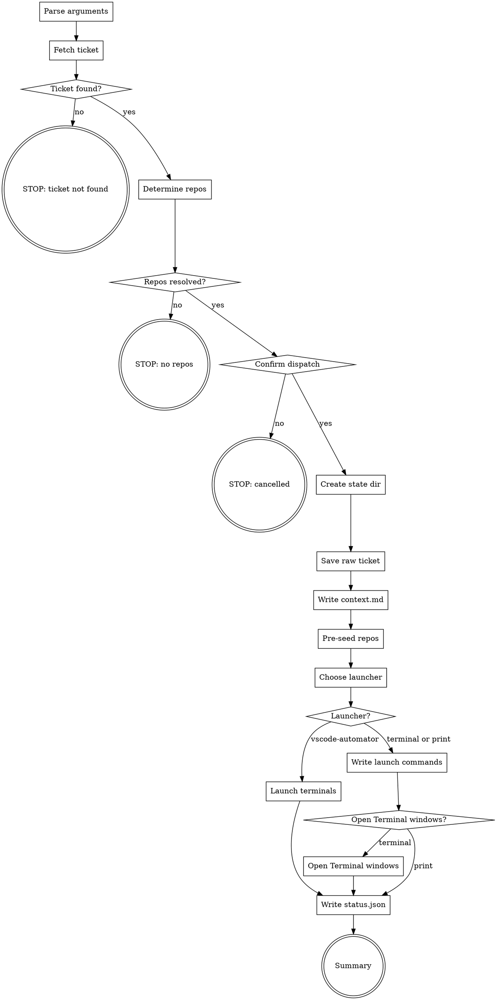

You dispatch a ticket to one or more repos by opening independent CLI sessions — Claude Code (default) or Copilot CLI, per `hub.engine` — one per repo. The hub does NOT plan or implement — it fetches the ticket, determines which repos are involved, and launches real sessions in each repo with a delegation prompt.

`${CLAUDE_SKILL_DIR}` below is this skill's directory; on a host that does not substitute it (Copilot CLI), run the scripts from this skill's folder (`scripts/…` next to this file).

## Tool names by host

Tool calls in this skill are written with Claude Code names. Other hosts register the same server's tools under another name — call the form your host lists:

| Server | Claude Code | Copilot CLI |
|--------|-------------|-------------|
| ADO | `mcp__ado__wit_work_item` | `ado-wit_work_item` |
| Atlassian | `mcp__atlassian__jira_get_issue` | `atlassian-jira_get_issue` |
| vscode-automator | `mcp__vscode-automator__vscode_new_terminal` | `vscode-automator-vscode_new_terminal` |

The rule: Claude Code `mcp__<server>__<tool>`, Copilot CLI `<server>-<tool>`. Arguments are identical. If neither form of a tool is in your tool list, that server is not connected in this session — say so by name; never substitute a different tool for it.

## Pre-flight

Resolve the hub config:

```bash
bash "${CLAUDE_SKILL_DIR}/scripts/hub-config.sh" .ai/config.yaml
```

- **exit 2 / 3** — no config, or `hub.enabled` is not `true` → STOP:
  > Hub mode is not enabled. Run `/dx-hub-init` first.
- **exit 4** — a value is invalid (engine, launcher, terminal-delay). Print the `warn:` lines and STOP; do not guess a replacement.
- **exit 0** — use the `KEY=VALUE` lines as the settings for this run:
  - `engine` — CLI started in each repo: `claude` (default) or `copilot`
  - `model` — passed as `--model <value>` to that CLI (empty: the CLI's own default)
  - `terminal_delay` — seconds to wait for Claude to start in a vscode-automator terminal (default `5`)
  - `launcher` — how sessions are started: `auto` (default), `vscode-automator`, `terminal`, `none` (see **Choose launcher**)
  - `provider` — `ado` (default) or `jira` (`tracker.provider`, falling back to `scm.provider`)
  - `scm_project` — hub-wide ADO project, often unset in a hub
  - `repo=<name>\t<path>\t<ado-project>\t<capabilities>\t<keywords>` — one line per `repos[]` entry

  **Print every `default:` and `warn:` line** the script wrote to stderr, under a `Config:` heading, before anything else. Defaults are applied, never hidden. If any `default:` line appeared, add one line: `Run /dx-hub-config fill-defaults to write these into .ai/config.yaml.`

**If provider = jira:** also read `jira.url` and `jira.project-key` from `.ai/config.yaml`.

## Flow



## Node Details

### Parse arguments

Parse `$ARGUMENTS`:

1. **Ticket ID** (required) — first positional arg. Numeric ADO ID, Jira key (`PROJ-123`), or full URL. Extract ID from URLs. An ADO URL also carries the project (`/<org>/<project>/_workitems/edit/<id>`) — keep it as the first project candidate.
2. **Repo names** (optional) — additional positional args matching `repos[].name` from config. If provided, skip auto-detection and use these.
3. **`--skill`** (optional) — skill to run in each repo. Default: `/dx-agent-all`.
4. **`autonomous`** (optional) — appended to the skill call in every repo (`<skill> <id> autonomous`), so each repo session runs without stops. Also makes this dispatch itself skip **Confirm dispatch**.
5. **`--no-launch`** (optional) — do everything up to the terminals, but open none: write each repo's exact command line into `status.json` for the tool that called this skill (a dashboard, a script) to start itself. Same as `hub.launcher: none` for this run.

Examples:
```
/dx-hub-dispatch 2471234
/dx-hub-dispatch 2471234 repo-fe repo-be
/dx-hub-dispatch 2471234 --skill /dx-req
/dx-hub-dispatch PROJ-123 repo-fe --skill /dx-agent-all
/dx-hub-dispatch 2471234 repo-fe repo-be autonomous
/dx-hub-dispatch 2471234 repo-fe repo-be autonomous --no-launch
```

### Fetch ticket

Fetch the work item using the configured provider.

**ADO — always pass a project.** A hub spans repos that can live in different ADO projects, and the ADO MCP server asks interactively for a project when none is passed — which fails as "Project selection cancelled" in an agent session. Build the candidate list, in order, without duplicates:

1. the project from a ticket URL argument
2. the `ado-project` of each repo named on the command line
3. `scm_project`
4. the `ado-project` of every other `repos[]` entry

If the list is empty, STOP: `No ADO project configured — set scm.project or repos[].ado-project in .ai/config.yaml.`

Try each candidate until one returns the item (work item IDs are unique across an organization, so the first hit is the ticket; a "not found" in one project only means "try the next"):

```
mcp__ado__wit_work_item
  action: "get"
  project: "<candidate>"
  id: <work item ID>
  expand: "Relations"
```

Set **TICKET_PROJECT** = the item's `System.TeamProject` field (not the candidate that happened to work). Use TICKET_PROJECT for every later ADO call about this ticket, starting with the comments:

```
mcp__ado__wit_work_item
  action: "list_comments"
  project: "<TICKET_PROJECT>"
  workItemId: <id>
```

**Jira:**
```
mcp__atlassian__jira_get_issue
  issue_key: "<issue key>"
```

Extract and hold in memory:
- **ID** — work item ID or Jira key
- **Project** — TICKET_PROJECT (ADO) or the issue's project key (Jira)
- **Title** — work item title
- **Type** — User Story, Bug, Task, etc.
- **Area path** — `System.AreaPath` (ADO) or components (Jira)
- **Tags** — `System.Tags` (ADO) or labels (Jira)
- **Description** — full description text
- **Acceptance Criteria** — if present
- **State** — current state
- **Relations** — linked items

### Ticket found?

- **yes** — one candidate returned the item → "Determine repos"
- **no** — every candidate failed → "STOP: ticket not found"

### STOP: ticket not found

Print the ticket ID, each project tried and the error each returned. STOP.

### Determine repos

If repo names were provided as arguments, use those directly — look them up in `repos[]` by name. An unknown name: print `⚠ No repo entry found for "<name>". Add it to repos: in .ai/config.yaml.` and ask the user.

If no repos were specified, determine from ticket content, in this order — stop at the first step that finds any repo:

1. **Name and keyword match** (deterministic). Write the ticket's title, area path and tags (one per line — not the description, which often names other products in passing) to `state/.match-<id>.txt`, then:

   ```bash
   bash "${CLAUDE_SKILL_DIR}/scripts/match-repos.sh" .ai/config.yaml state/.match-<id>.txt
   ```

   Exit 0 prints `<repo>\t<reason>` per match — a repo whose full name, one of its `repos[].keywords`, or a distinctive token of its name (a brand or product word, e.g. `brand-a` in `site-brand-a-global`) appears in the text. Tokens shared by several repo names and generic words (`platform`, `core`, `experience`, `site`, `global`…) never match. Exit 8 = no match → step 2. Delete the temp file afterwards.

2. **Capability match.** From the title and description:
   - "frontend", "FE", "UI", "React", "Angular" → repos with `fe` in `capabilities`
   - "backend", "BE", "API", "service", "endpoint" → repos with `be`
   - "full stack", "both", "end-to-end" → repos with `fe` or `be`
   Repos with no `capabilities` never match here (`hub-config.sh` warned about them in Pre-flight).

3. **Linked work items** — child tasks with repo-specific titles are hints for steps 1–2.

4. **Still ambiguous** — ask the user which repos to dispatch to, showing the full repo list with each repo's capabilities and keywords.

Show the reason next to each picked repo in **Confirm dispatch** (`name-token:brand-a`, `capability:fe`, `argument`).

### Repos resolved?

- **yes** — at least one repo matched → proceed to "Confirm dispatch"
- **no** — no repos could be determined → go to "STOP: no repos"

### STOP: no repos

Print:
```
Could not determine which repos are involved in ticket <id>.

Available repos:
  - <name> (capabilities: <caps or none>; keywords: <kws or none>) — <path>
  ...

Re-run with explicit repos: /dx-hub-dispatch <id> <repo-name> [<repo-name> ...]
Or add capabilities / keywords to repos[] in .ai/config.yaml.
```
STOP.

### Confirm dispatch

Print the dispatch plan:
```
Hub Dispatch Plan
─────────────────────────────
Ticket:  <id> — <title>
Project: <TICKET_PROJECT>
Type:    <type>
Skill:   <skill>
Engine:  <claude | copilot>
Repos:   <repo-a> (<caps> — <reason>), <repo-b> (<caps> — <reason>)

This will start <N> independent <Claude Code | Copilot CLI> sessions, one per repo.
Proceed? [Y/n]
```

**Non-interactive** (`autonomous` argument, or nobody can answer — dx-core `shared/interaction-mode.md`): print the plan and proceed without asking.

- **yes** (or Enter) → proceed
- **no** → go to "STOP: cancelled"

### STOP: cancelled

Print: `Dispatch cancelled.` STOP.

### Create state dir

```bash
HUB_ROOT="$(pwd)"
STATE_DIR="state/<ticket-id>"
mkdir -p "$STATE_DIR"
```

### Save raw ticket

Determine the correct filename based on ticket type:
- **Bug** type → `raw-bug.md`
- **All other types** (User Story, Task, etc.) → `raw-story.md`

Write the raw ticket content to `$STATE_DIR/<filename>` using the same faithful-dump format as `dx-req` (for stories) or `dx-bug-triage` (for bugs). Do NOT editorialize — this is a faithful copy of the ADO/Jira content.

For detailed format, follow the same structure as `dx-req` step 10 or `dx-bug-triage` step 9.

### Write context.md

Write `$STATE_DIR/context.md`:

```markdown
# Cross-Repo Context

**Ticket:** <id> — <title>
**Project:** <TICKET_PROJECT>
**Type:** <type>
**Dispatched:** <ISO timestamp>

## Involved Repos

| Repo | Role | ADO project | Path |
|------|------|-------------|------|
| <repo-a> | <capabilities as role: fe→Frontend, be→Backend; none → "—"> | <repos[].ado-project> | <absolute path> |
| <repo-b> | <role> | <ado-project> | <absolute path> |

## Coordination Notes

- Each repo runs its own requirements analysis and implementation planning.
- The ticket lives in ADO project <TICKET_PROJECT>; a repo's own `scm.project` may differ — pass the ticket's project when reading or commenting on it.
- This ticket involves multiple repos — coordinate shared interfaces (API contracts, shared types, event schemas) carefully.
- If you need to know what another repo is doing, check its spec directory: `<other-repo-path>/.ai/specs/<ticket-slug>/`

## What Each Repo Handles

<For each repo, write 1-2 sentences about what that repo's focus should be based on the ticket content and the repo's capabilities. Keep it brief — the repo's own dx-req will do the deep analysis.>
```

### Pre-seed repos

For each target repo:

```bash
DIR_NAME="<id>-<slugified-title>"            # same slugify logic as dx-req
REPO_SPEC_DIR="<repo-abs-path>/.ai/specs/${DIR_NAME}"
mkdir -p "$REPO_SPEC_DIR"
cp "$STATE_DIR/<raw-story.md|raw-bug.md>" "$REPO_SPEC_DIR/"
```

This pre-seeds each repo so `dx-req` / `dx-bug-triage` will find `raw-story.md` / `raw-bug.md` already present and skip the ADO/Jira fetch.

### Choose launcher

Resolve one of three outcomes — `vscode-automator`, `terminal` or `print` — and print it with its reason (`Launcher: print — vscode-automator tools not in this session`):

| Condition | Outcome |
|-----------|---------|
| `--no-launch`, or `launcher` = `none` | `print` |
| `launcher` = `terminal` and `command -v osascript` succeeds (macOS) | `terminal` |
| `launcher` = `terminal`, no `osascript` | `print` — say why |
| `launcher` = `auto` or `vscode-automator`, and the vscode-automator tools are available | `vscode-automator` |
| `launcher` = `auto` or `vscode-automator`, tools not available | `print` — say why |

**Are the vscode-automator tools available?** Look for `vscode_new_terminal` from the `vscode-automator` server in your tool list, in your host's form (see **Tool names by host**). On Claude Code, if it is not loaded, one `ToolSearch` for `vscode_new_terminal` settles it. Found → available. Not found → not available: do **not** try other terminal tools, `ide` tools, shell tricks or AppleScript in its place — the fallback is `print`, which loses nothing (every command is written and shown).

Copilot CLI sessions usually have no vscode-automator server, so with `launcher: auto` they land on `print`; set `hub.launcher: terminal` to have the hub open the sessions itself on macOS.

### Launcher?

- **vscode-automator** → "Launch terminals"
- **terminal** or **print** → "Write launch commands"

### Launch terminals

For each target repo (tool names in their Claude Code form — see **Tool names by host**):

1. `mcp__vscode-automator__vscode_new_terminal` — wait 1 second.
2. `mcp__vscode-automator__vscode_type` `text: "cd <repo-absolute-path>"`, then `mcp__vscode-automator__vscode_keystroke` `key: "return"` — wait 1 second.
3. Start the CLI, per `engine`:
   - **`claude` (default):** type `claude` (with `model` set: `claude --model <model>`), keystroke `return`, wait `terminal_delay` seconds, then type the **delegation prompt** and keystroke `return`.
   - **`copilot`:** the prompt goes on the command line, so this is one command. Make a **lowercase** session id per repo — Copilot CLI uses it as the session folder name (`~/.copilot/session-state/<uuid>/`), which lets a tool read that terminal's usage — and keep it for **Write status.json**. The same id goes into `DX_RUN_ID`, so the repo's run result (`.ai/run-results/`, `run_id`) points back to this terminal:
     ```bash
     uuidgen | tr 'A-Z' 'a-z'
     ```
     Type `DX_RUN_ID=<uuid> copilot --session-id <uuid> [--model <model>] -i "<delegation prompt>"` and keystroke `return`.
4. Wait 2 seconds before the next repo (avoids focus conflicts).

**Delegation prompt** — one line; no `"`, `$` or backticks (the command-line paths put it inside a shell double-quoted string):

```
Ticket <id> (ADO project <TICKET_PROJECT>) raw content is pre-seeded at .ai/specs/<dir-name>/<raw-file>. Cross-repo context at <hub-abs-path>/state/<ticket-id>/context.md — read it before starting. You handle the <repo-name> portion (<role>). Also involved: <other-repos-and-roles>. When done or blocked, update status in <hub-abs-path>/state/<ticket-id>/status.json — set repos.<repo-name> to done, blocked, or failed. Now run: <skill> <ticket-id>[ autonomous]
```

(Jira: `(Jira project <key>)` in place of the ADO project.) Copilot CLI only knows plugin skills by their **plugin-prefixed** name, so for the `copilot` engine write the skill as `/dx-core:<name>` (`/dx-agent-all` → `/dx-core:dx-agent-all`; a skill already carrying a `plugin:` prefix stays as is).

### Write launch commands

Start nothing in this node. For each target repo:

1. Make a lowercase session id: `uuidgen | tr 'A-Z' 'a-z'`.
2. Build the delegation prompt exactly as in **Launch terminals** (one line, no `"`, `$` or backticks; Copilot gets the `/dx-core:` skill prefix).
3. Write the repo's launch script and get its command line:

   ```bash
   bash "${CLAUDE_SKILL_DIR}/scripts/build-launch.sh" --engine <engine> \
     --cwd "<repo-abs-path>" --session <uuid> --prompt "<delegation prompt>" \
     --out "$STATE_DIR/launch/<repo-name>.sh" [--model <model>]
   ```

   It prints the command line — `DX_RUN_ID=<uuid> copilot --session-id <uuid> [--model <model>] -i "<prompt>"` or `DX_RUN_ID=<uuid> claude --session-id <uuid> [--model <model>] "<prompt>"` — and writes an executable script that `cd`s into the repo and runs it. Exit 2 means a bad argument (usually a `"`, `$` or backtick in the prompt): fix the prompt and run it again.

Keep `cwd`, `command`, `script` (absolute path) and the session id per repo for **Write status.json**.

### Open Terminal windows?

- **terminal** → "Open Terminal windows"
- **print** → "Write status.json" (each repo stays `pending`)

### Open Terminal windows

macOS only. For each repo, open one Terminal.app window that runs its script:

```bash
osascript -e "tell application \"Terminal\" to do script \"bash '<absolute script path>'\""
```

Wait 2 seconds between repos. A non-zero exit (usually macOS asking to allow automation of Terminal) → leave that repo `pending`, print the error, and carry on with the next repo; the summary lists its command. Repos whose window opened are `running`.

### Write status.json

Write `$STATE_DIR/status.json`:

```json
{
  "ticket": "<ticket-id>",
  "title": "<title>",
  "type": "<type>",
  "project": "<TICKET_PROJECT or Jira project key>",
  "skill": "<skill>",
  "engine": "<claude | copilot>",
  "launcher": "<vscode-automator | terminal | print>",
  "started": "<ISO timestamp>",
  "repos": {
    "<repo-a>": "running",
    "<repo-b>": "pending"
  },
  "sessions": {
    "<repo-a>": "<uuid>",
    "<repo-b>": "<uuid>"
  },
  "launch": {
    "<repo-a>": { "cwd": "<repo-a absolute path>", "command": "<command line>", "script": "<abs path to launch/<repo-a>.sh>" },
    "<repo-b>": { "cwd": "<repo-b absolute path>", "command": "<command line>", "script": "<abs path to launch/<repo-b>.sh>" }
  }
}
```

- `repos.<name>`: `running` once a session was started (vscode-automator, or a Terminal window that opened); `pending` when nothing started it yet. The repo sessions set `done` / `blocked` / `failed`; `/dx-hub-status` reads it.
- `sessions`: written for the `copilot` engine and whenever `launch` is written.
- `launch`: written for the `terminal` and `print` launchers — run `script` (or `command` in `cwd`), one terminal per repo.

### Summary

Print:

```
Hub Dispatch Started
────────────────────────────────
Ticket:    <id> — <title>  (<TICKET_PROJECT>)
Skill:     <skill>
Launcher:  <launcher> — <reason>
Sessions:  <N> started, <M> waiting to be started

  <repo-a> (<role>) — running   [<session id>]
  <repo-b> (<role>) — pending

State: state/<ticket-id>/
```

For every `pending` repo, print how to start it, ready to paste into any terminal (a VS Code terminal works):

```bash
bash '<absolute script path>'
```

…and under it the full command line, for a caller that prefers `cwd` + `command`. With the `print` launcher, say in one line that nothing was started and why (`--no-launch`, `hub.launcher: none`, or vscode-automator not available in this session).

Then:
```
Next:
  /dx-hub-status <ticket-id>    — check progress
```

## Example: Copilot CLI without vscode-automator

```
/dx-hub-dispatch 2471234 brand-a-site
```
`launcher: auto` finds no vscode-automator tools → writes `state/2471234/launch/brand-a-site.sh` and prints `bash '<path>'` to start it. With `hub.launcher: terminal` the hub opens a Terminal.app window for it instead.

## Troubleshooting

### VS Code terminals not opening
**Cause:** vscode-automator MCP server not running in this session, or macOS Accessibility permission not granted.
**Fix:** The dispatch already fell back to `print` and listed one `bash '<script>'` line per repo — run those. To get terminals opened for you: register vscode-automator in the hub's `.mcp.json` (Claude Code) and grant your terminal app Accessibility permission, or set `hub.launcher: terminal` (macOS Terminal.app, works from any host).

### "Project selection cancelled" from ADO
**Cause:** an ADO call without `project`.
**Fix:** set `repos[].ado-project` for every repo (or `scm.project`). Dispatch passes a project on every call and reads the ticket's own `System.TeamProject` after the first fetch.

### Claude not starting in terminal
**Cause:** `hub.terminal-delay` too short — Claude CLI takes time to initialize.
**Fix:** Increase `hub.terminal-delay` in `.ai/config.yaml` (try `8` or `10`).

### Copilot CLI: "Unknown command" in a repo terminal
**Cause:** the skill was typed without its plugin prefix.
**Fix:** use `/dx-core:<skill>` in the delegation prompt (see Launch terminals). Run `copilot` in that repo and check the plugin is enabled if the prefixed name also fails.

### Wrong repo detected
**Cause:** the title, area path and tags name no repo or keyword, and the FE/BE guess picked the wrong repos.
**Fix:** add `keywords: [<product or brand words>]` to the repo in `repos[]`, or re-run with explicit repo names: `/dx-hub-dispatch <id> <repo-name>`.

### Raw ticket not found in repo
**Cause:** Pre-seed step failed (directory permissions or path mismatch).
**Fix:** Check that repo paths in config are correct. The raw file should be at `<repo>/.ai/specs/<id>-<slug>/raw-story.md`.

## Rules

- **Hub never plans or implements** — it only fetches, routes, and launches
- **No hardcoded values** — all org names, project names, paths from config
- **No silent defaults** — every value the config lacks is printed with the default used
- **Always pass the ADO project** — from the candidates, then the ticket's `System.TeamProject`
- **Pre-seed raw files** — copy to each repo so skills skip redundant ADO fetches
- **One session per repo** — each gets its own independent Claude Code or Copilot CLI session (`hub.engine`); with `copilot`, each repo has its own lowercase `--session-id`, recorded in `status.json` `sessions`
- **Missing launcher → print, never improvise** — without vscode-automator tools the commands are written and shown; only `hub.launcher: terminal` opens windows another way
- **vscode-automator and the `terminal` launcher are macOS only** — `print` works everywhere
